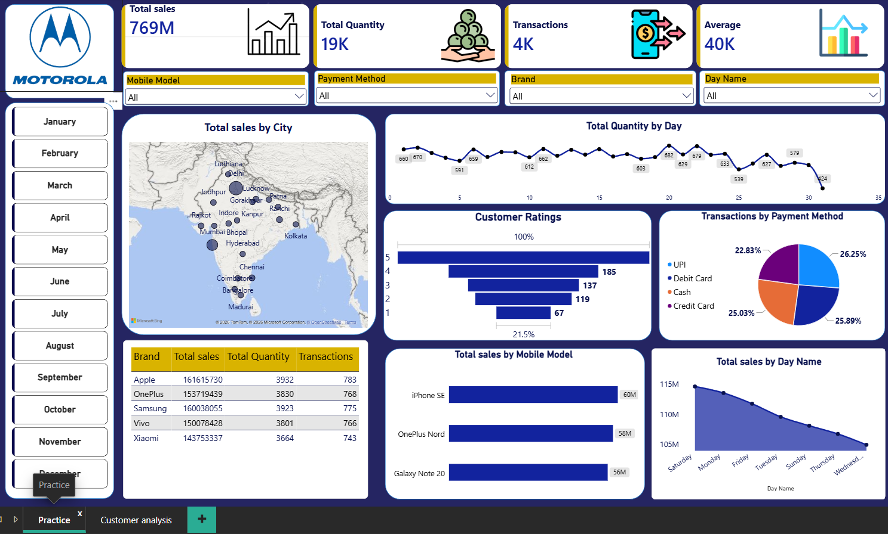
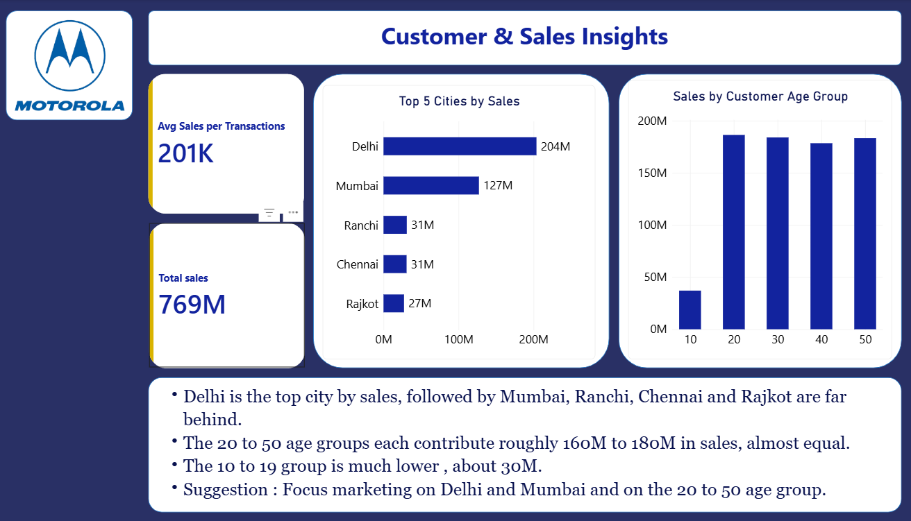

# Motorola Mobile Sales Dashboard (Practice Project)

This is my **first Power BI project**, made for learning and practice only. It is not for commercial use.

## Credits and Disclaimer
- Page 1 (Practice) was made by following the Power BI tutorial by **Satish Sir** on YouTube: https://youtu.be/KdC5R7oPCAI?si=M1Z_z2sTqNKJ3Iyh. The dataset and the original dashboard idea belong to him and are used here for learning only.
- Page 2 (Customer & Sales Insights) is my own analysis on the same dataset.
- I do not claim ownership of the tutorial content, dataset, or the Motorola name and logo. All trademarks belong to their owners.
- If the owner wants anything removed, please contact me and I will take it down.

## Tools Used
Power BI

## Page 1: Sales Overview
KPI cards (769M total sales, 19K units, 4K transactions), sales by city map, payment method, mobile model and day, customer ratings, and slicers for brand, model, payment method, day and month.

## Page 2: Customer & Sales Insights (my analysis)
- Delhi (204M) and Mumbai (127M) are the top cities by sales
- Ages 20-50 each contribute about 160-180M; ages 10-19 about 30M
- Suggestion: focus marketing on Delhi, Mumbai and ages 20-50

## What I Learned
Building KPI cards, charts and slicers, and writing business insights from data.

## Author
Sanika
LinkedIn: https://www.linkedin.com/in/sanika-rangari02
